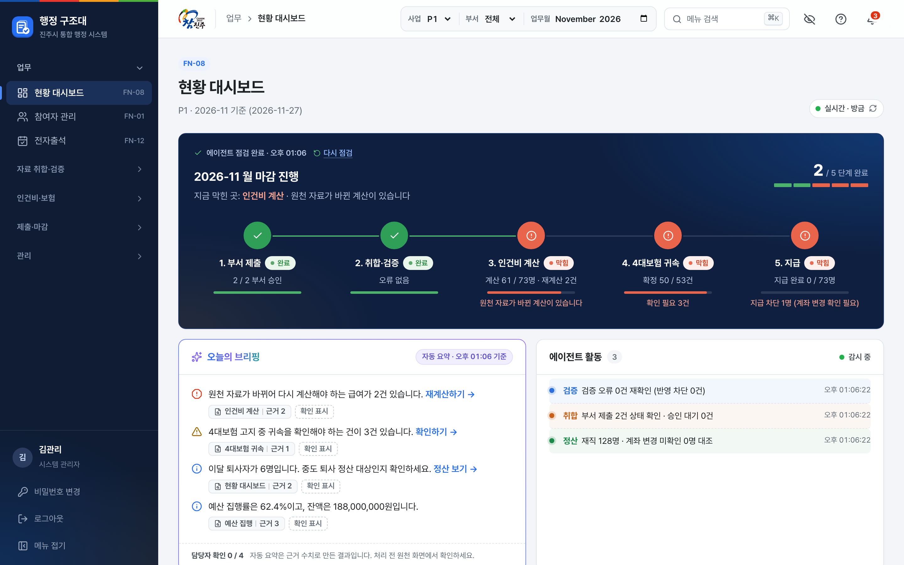
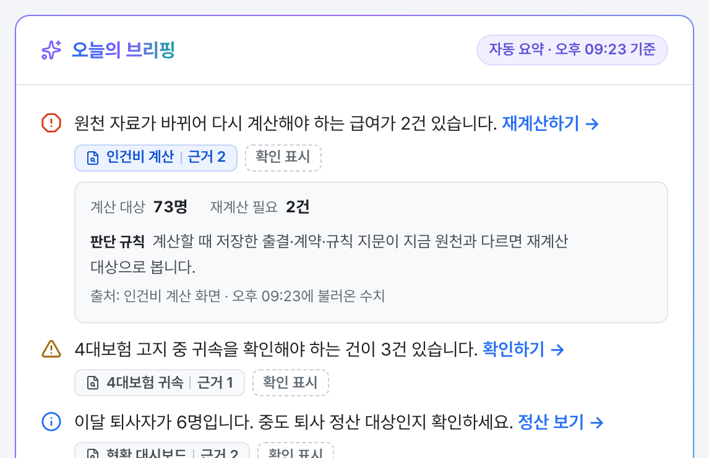
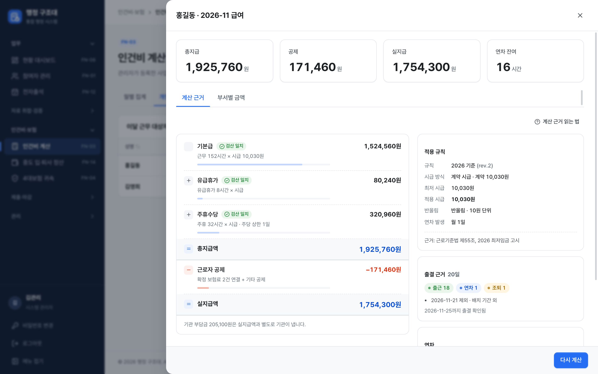
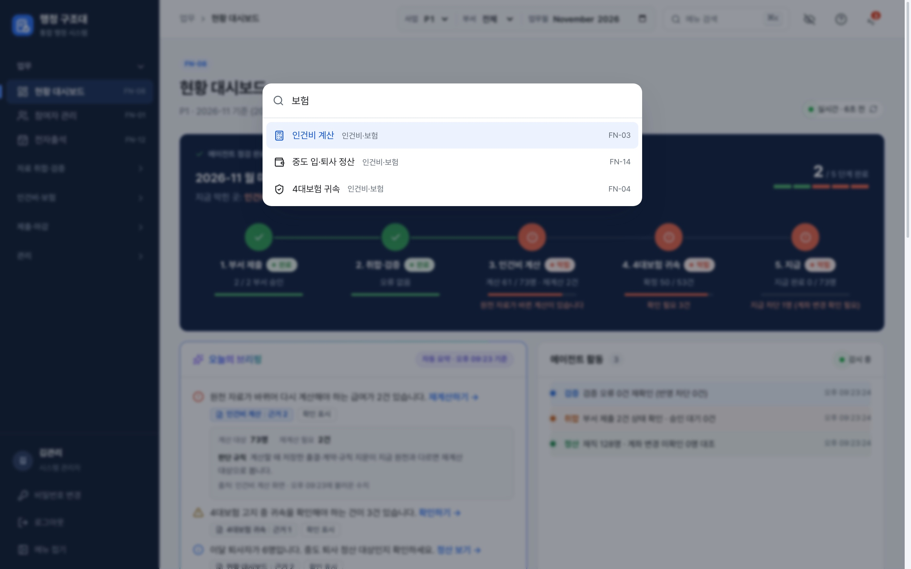
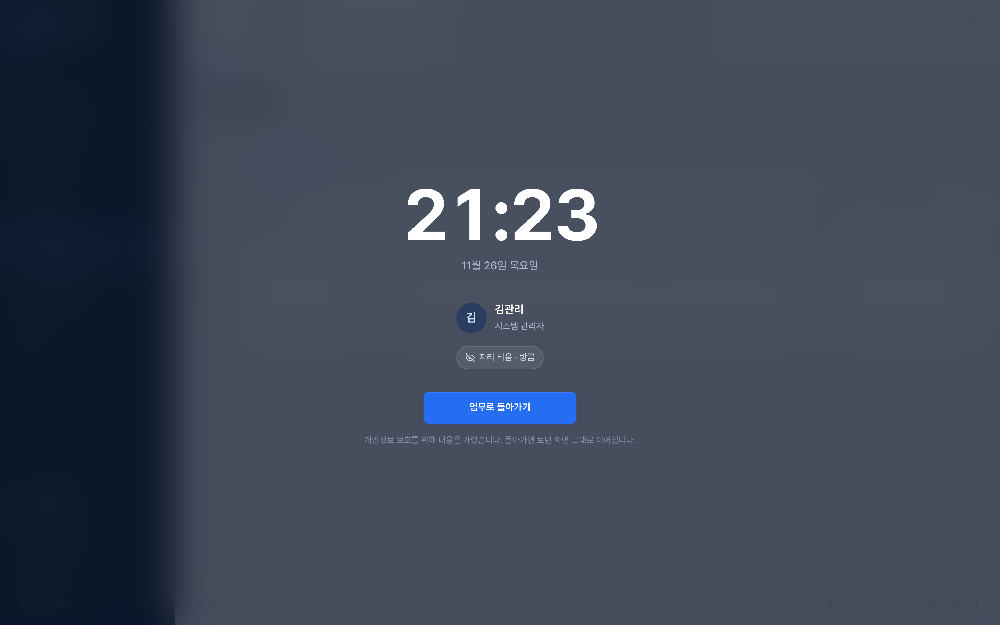
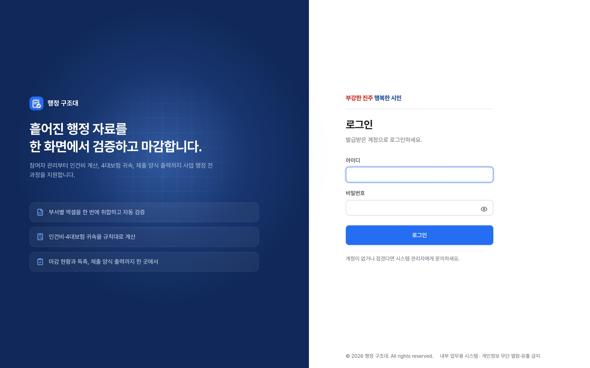

<div align="center">


# 행정 구조대

**사업 참여자 인건비 정산을 에이전트와 함께 처리하는 행정 업무 웹**

부서별 엑셀 취합 → 검증 → 인건비 계산 → 4대보험 귀속 → 지급·제출 양식 출력까지<br />
월 마감 흐름을 한 화면에서 따라갑니다.

[](https://github.com/Junseung0526/haengjeong-rescue-web/actions/workflows/ci.yml)
[](https://haengjeong-rescue-web.vercel.app)


[**데모 보기**](https://haengjeong-rescue-web.vercel.app) · [주요 기능](#주요-기능) · [화면 목록](#화면-목록) · [시작하기](#시작하기)

<br />



</div>

<br />

> 개인 작업 중인 프론트엔드입니다. 백엔드(FastAPI)는 별도 저장소 [YC-CapstoneDesign-5/Back](https://github.com/YC-CapstoneDesign-5/Back)에 있고, 이 프론트는 그 API를 그대로 사용합니다.
> 이 문서의 화면은 모두 **임시 데이터**로 찍었습니다.

## 주요 기능

<table>
<tr>
<td width="50%" valign="top">

### 근거가 보이는 오늘의 브리핑
현황 수치에서 지금 처리할 일을 문장으로 정리합니다. 문장마다 **출처·사용한 수치·판단 규칙**을 펼쳐 보고, 담당자가 **확인 표시**를 남깁니다. 규칙 기반 요약이라 외부 언어 모델을 부르지 않습니다.

</td>
<td width="50%"></td>
</tr>
<tr>
<td width="50%"></td>
<td width="50%" valign="top">

### 계산 근거 보기
개인별 급여가 **기본급 → 유급휴가 → 주휴 → 공제 → 실지급** 순서로 쌓이는 과정을 보여주고, 화면에서 다시 검산해 서버 금액과 같으면 **검산 일치**로 표시합니다. 적용된 규칙 버전과 출결 근거도 함께 봅니다.

</td>
</tr>
<tr>
<td width="50%" valign="top">

### ⌘K 빠른 이동
`⌘K`(Windows `Ctrl+K`)로 메뉴와 **추천 할 일**을 검색하고, `/`로 표 검색창에 바로 들어갑니다. 탭·필터·검색어는 주소에 남아 새로고침하거나 공유해도 그대로입니다.

</td>
<td width="50%"></td>
</tr>
<tr>
<td width="50%"></td>
<td width="50%" valign="top">

### 자리 비움 화면
**5분 동안 작업이 없거나** 상단 버튼을 누르면 개인정보가 보이지 않게 화면을 가립니다. 뒤 화면은 흐리게 덮고 키보드·스크린리더로도 닿지 않게 하며, 돌아가면 보던 화면 그대로 이어집니다.

</td>
</tr>
</table>

### 그 밖에

- **월 마감 진행 카드**: 제출 → 검증 → 인건비 → 4대보험 → 지급 5단계를 실제 API 수치로 판정하고, 막힌 단계와 이유를 보여줍니다. 누르면 해당 화면으로 이동합니다.
- **에이전트 활동**: 30초마다 수치를 다시 확인하고, 이전과 달라진 결과는 '확인 필요'로 담당자에게 넘깁니다.
- **화면 안내 투어**: 처음 여는 화면마다 단계별 안내가 뜨고, 상단 `?` 버튼으로 다시 볼 수 있습니다.
- **코드 대신 이름으로**: 표·폼·제목 어디서나 사업·부서·기관을 코드(`P01`, `D01`) 대신 이름으로 보고 고릅니다. 코드는 이름에 마우스를 올리면 보입니다.
- **메뉴**: 묶음별로 접고 펼치며, 로고를 눌러 아이콘만 남길 수 있습니다. 작은 화면에서는 자동으로 접힙니다.
- **반응형**: 노트북부터 2560px 모니터까지 내용 폭과 메뉴가 맞춰집니다.
- KRDS(범정부 디자인 시스템) 색·타이포 기준, Pretendard 글꼴.

<details>
<summary><b>로그인 화면</b></summary>
<br />

</details>

## 화면 목록

| 경로 | 화면 | 기능 코드 |
|---|---|---|
| `/` | 현황 대시보드 (월 마감 진행, 오늘의 브리핑, 에이전트 활동) | FN-08 |
| `/participants` | 참여자 관리 | FN-01 |
| `/attendance` | 전자출석 | FN-12 |
| `/submissions` | 부서 제출 포털 | FN-09 |
| `/ingest` | 엑셀 취합 (미리보기 → 확정 반영 → 취소) | FN-02 |
| `/validation` | 검증 오류 | FN-05 |
| `/changes` | 전월 대비 변경 (계좌 변경 확인 등) | FN-11 |
| `/ocr` | 스캔 출석부 대조 | FN-06 |
| `/payroll` | 인건비 계산 (월별 집계·개인별 계산·계산 규칙, 계산 근거 보기) | FN-03 |
| `/settlements` | 중도 입·퇴사 정산 | FN-14 |
| `/insurance` | 4대보험 귀속 | FN-04 |
| `/exports` | 제출 양식 출력 | FN-07·16 |
| `/deadlines` | 마감·독촉 | FN-15 |
| `/notifications` | 알림 | FN-15 |
| `/admin/*` | 계정·권한, 부서, 감사 로그, 오류 이력, 개인정보 파기 | NFR-08·09·10·18 |

메뉴는 로그인한 사용자의 역할에 따라 보이는 항목이 달라집니다.

## 기술 스택

- React 19, React Router 7, Vite 8
- lucide-react (아이콘), Oxlint (린트)
- 상태 관리 라이브러리 없이 React Context + `useApi` 훅

## 시작하기

Node.js 20 이상이 필요합니다.

```bash
npm install
```

백엔드 주소를 `.env.local`에 적습니다 (커밋하지 않는 파일).

```bash
API_URL=https://your-backend.example.com
```

```bash
npm run dev
```

개발 서버가 `/api`, `/health` 요청을 `API_URL`로 넘깁니다. `API_URL`이 없으면 `http://localhost:8000`(로컬 FastAPI)을 사용합니다.

| 명령 | 설명 |
|---|---|
| `npm run dev` | 개발 서버 |
| `npm run build` | `dist`에 배포용 빌드 |
| `npm run preview` | 빌드 결과 미리보기 |
| `npm run lint` | Oxlint 검사 |

## CI/CD · Vercel 배포

| 언제 | 하는 일 |
|---|---|
| PR을 올리거나 고칠 때 | GitHub Actions(`.github/workflows/ci.yml`)가 린트·빌드 검사, Vercel이 **미리보기** 배포 (PR에 주소 댓글) |
| `main`에 머지될 때 | 같은 검사 + Vercel **운영** 배포 |

배포는 Vercel의 GitHub 연동이 맡아서 별도 토큰·시크릿이 필요 없습니다.
`vercel.json`이 `/api`, `/health`를 백엔드로 넘기고, 나머지 경로는 `index.html`로 돌려줍니다.

> Actions 검사와 Vercel 배포는 따로 돌기 때문에, 검사가 실패해도 배포는 진행됩니다. 빨간 X가 뜬 PR은 머지하지 마세요.
> 막으려면 GitHub Settings → Branches에서 `main`에 "Require status checks to pass" 규칙을 거세요.

### 백엔드 주소 바꾸기

지금은 임시 터널(trycloudflare) 주소를 쓰고 있어서, 터널을 다시 열면 주소가 바뀝니다.
그때는 `vercel.json`의 두 `destination` 주소를 새 주소로 고쳐 PR로 올리면 됩니다.

## 배포할 때 주의

- 프론트는 API를 상대 경로(`/api`)로 호출하고, 백엔드에는 CORS 설정이 없습니다. 그래서 **정적 호스팅만으로는 동작하지 않습니다.**
  화면 파일과 `/api`를 같은 주소에서 제공해야 합니다. 예: nginx가 `dist`를 내보내고 `/api`를 백엔드로 넘기는 구성, 또는 Vercel/Netlify의 경로 프록시.
- 주소 기반 라우팅(`BrowserRouter`)이라, 서버가 모르는 경로는 `index.html`을 돌려주도록 설정해야 새로고침해도 404가 나지 않습니다.
- 개인정보·급여를 다루므로 실제 운영은 내부망 배포를 전제로 합니다 (NFR-05).

## 폴더 구조

```
.
├─ index.html
├─ vite.config.js        # 개발 서버 프록시 (/api → API_URL)
├─ public/               # 파비콘
├─ docs/screenshots/     # README 화면 (임시 데이터)
└─ src/
   ├─ main.jsx
   ├─ App.jsx            # 로그인, 레이아웃(사이드바·상단 바), 라우팅, ⌘K 명령 창
   ├─ api.js             # fetch 래퍼, 토큰, 오류 메시지 정리
   ├─ ui.jsx             # 공통 컴포넌트(표·탭·모달·카드 등), useApi, useUrlState, 상태 라벨
   ├─ agents.jsx         # 에이전트 정의, 화면 안내 투어, 로그인 인트로
   ├─ index.css          # 전체 스타일
   └─ pages/             # 화면별 컴포넌트
```
